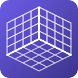

<p align="center">
  
</p>

<h1 align="center">MotocalGUI</h1>

<p align="center">
  Align mixed VR tracking spaces on Linux
</p>

---

MotocalGUI is a hard fork of [SpaceCal for Monado](https://github.com/99oblivius/spacecal-for-monado), featuring a GTK4 frontend powered by libmotoc.

MotocalGUI uses [libmotoc](https://docs.rs/libmotoc/0.4.0/libmotoc/) for sampled calibration, tracking-origin corrections, recentering, and OpenXR initialization. MotocalGUI aligns VR devices from different tracking systems into a single unified space through the Monado OpenXR runtime. Use your Quest headset with lighthouse-tracked controllers, Vive trackers, or any mix of tracking technologies.

## Features

- **Calibrate** — hold both devices firmly together and slowly move and rotate them in different directions. Audio cues and a progress bar guide you through.
- **Recenter** — face forward and press Recenter. Floor height is preserved.
- **Reset** — reset the target tracking origin, any tracking origin from the dropdown, or the entire STAGE/LOCAL reference space (position, orientation, and height).
- **Device identification** — open a dropdown and move a device to see which one it is.
- **Battery status** — see charge levels for all your tracked devices.
- **Shared calibration** — libmotoc reads and writes motoc’s default `last` profile at `$XDG_CONFIG_HOME/motoc/last.json` (usually `~/.config/motoc/last.json`). The UI restores it on startup and after reconnecting to the runtime; `motoc continue` loads the same file. Continuous profiles created by the CLI resume through libmotoc until a reset, a new calibration, or closing the UI.

## Installation

### Arch Linux

Build the Git version using the packaging recipe in this checkout:

```bash
makepkg -p PKGBUILD-git -si
```

### Debian / Ubuntu and Fedora

If packages are available for a MotocalGUI release, download them from the [MotocalGUI releases](https://github.com/ReinaS-64892/MotocalGUI/releases) page. Packages from the original SpaceCal project install the original application.

### NixOS

```bash
nix run github:ReinaS-64892/MotocalGUI
```

### From source

```bash
# Dependencies (Arch)
sudo pacman -S gtk4 libadwaita openxr monado cargo

# Dependencies (Fedora)
sudo dnf install gtk4-devel libadwaita-devel openxr-devel monado-devel cargo

# Build and install
git clone https://github.com/ReinaS-64892/MotocalGUI.git
cd MotocalGUI
cargo build --release --locked
sudo make PREFIX=/usr install
motocalgui
```

## Usage

Requires a Monado/WiVRn runtime exposing libmonado API 1.6 or later, `XR_MND_headless`, and `XR_MNDX_xdev_space`. Sample progress counts tracked poses; calibration times out after 120 seconds if tracking does not recover. Calibration and recentering offset writes are performed by libmotoc. Explicit resets and restoring saved tracking-origin offsets use libmonado directly, following the motoc CLI implementation. Other direct libmonado access reads device and battery information. Calibration and recentering follow libmotoc’s behavior. Device-based floor calibration and confidence scoring are not provided.

Calibration files are owned entirely by libmotoc, with the same format and profile name as the CLI. Existing profiles are read without being rewritten; a successful new calibration replaces `last.json`. A missing profile is normal on first use; unreadable or invalid profiles are reported without overwriting them. UI-only preferences (device selections, help visibility, and sample count) remain separate at `$XDG_DATA_HOME/motocalgui/config.json` (usually `~/.local/share/motocalgui/config.json`). Preferences are separate from the original SpaceCal application and are not imported automatically. The earlier UI-specific `motoc/spacecal-for-monado.json` calibration profile is also not imported automatically.

1. Start your Monado-based runtime (WiVRn, Monado standalone, etc.)
2. Launch MotocalGUI
3. Select your **source** (reference device) and **target** (device to align)
4. Grip both devices firmly together and click **Calibrate**
5. Wait for the countdown beeps to finish, then slowly move and rotate both devices together, turning and tilting them in different directions until the progress bar completes or you hear the chime

Keep the devices firmly together from start to finish so they cannot shift or twist relative to each other. Keep both devices tracked, and move slowly and steadily without sudden movements, following [motoc's calibration tips](https://github.com/galister/motoc#calibration-tips). If using a headset, hold the other device firmly against it while moving together.

## Acknowledgments

- [SpaceCal for Monado](https://github.com/99oblivius/spacecal-for-monado) by 99oblivius — original application from which this project was forked

- [OpenVR-SpaceCalibrator](https://github.com/pushrax/OpenVR-SpaceCalibrator) by pushrax — original calibration framework concept
- [motoc](https://github.com/galister/motoc) by galister — calibration and runtime foundation (libmotoc)
- Proof of concept was developed with Claude Opus 4.7

## License

GPL-3.0-only
